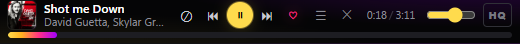
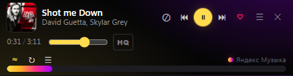

# ZvukYandex — настольный плеер Яндекс Музыки

Обёртка официального веб-плеера [music.yandex.ru](https://music.yandex.ru/): сайт живёт в своём
окне, а управлять им можно из полосы 48 px в углу экрана, из широкой плашки, из трея и
мультимедийными клавишами. Никакого обхода DRM и никакого реверс-API: играет тот же плеер,
что в браузере, подписка остаётся ваша.

Палитра — с обложки «Моей волны»: чёрное поле, жёлтый луч `#FFDB4D` и
фиолетово-малиновый край `#FF2E88 → #A100FF`.






## Что уже работает

- Окно с сайтом и входом в Яндекс ID; сессия сохраняется в профиле.
- **Компактная полоса 48 px**: обложка, «Трек — Артист», дизлайк, ⏮, ⏸/▶, ⏭, ♥, время, громкость,
  индикатор **HQ**, меню и закрытие. Прогресс внизу — перемотка кликом и протяжкой.
- **Широкая плашка ~420×110**: та же плашка плюс «Моя волна», повтор и очередь.
- **Меню на плашке** (`☰`): что играет, «Включить Мою волну», play/pause, prev/next,
  лайк, дизлайк, повтор, очередь, настройки звука, «Волна ▸», «Скрыть окно»,
  «Поверх всех окон», «Вид», «Запускать с Windows», «Выход», «Настройки…», «Папка профиля».
- **«Волна ▸»**: «Моя волна», «Незнакомое», «Для вас и Тренды» и то, что нашлось на
  главной странице. Список читается со страницы при открытии меню, поэтому новые
  подборки появляются сами.
- Трей: то же меню плюс подсказка «Трек — Артист».
- Мультимедиа-клавиши клавиатуры и горячие клавиши (см. ниже).
- Закрытие окна с сайтом или крестик на плашке — выход из приложения целиком;
  привычка «прятаться в трей» осталась настройкой `closeToTray`.
- Автозапуск с Windows (пункт меню).

## Запуск

Самый простой путь — двойной щелчок по **`Запустить.cmd`** в корне проекта. Скрипт ничего
не собирает: он запускает уже собранное приложение, а если `dist` ещё нет — соберёт один раз.

После правок в коде — **`Собрать.cmd`**, затем `Запустить.cmd`.

Вручную:

```powershell
npm install
npm run build
npm start
```

`npm start` запускает Electron с флагом `--no-sandbox`. На этой машине Chromium-песочница
Electron не поднимается (падение до выполнения кода), поэтому флаг нужен и в ярлыках
установщика. На машине, где песочница работает, флаг можно убрать.

## Первый вход

Первый запуск открывает сайт. Нажмите «Войти» и пройдите вход Яндекс ID как в браузере.
Сессия лежит в `%LOCALAPPDATA%\ZvukYandex\Partitions\yandex\Network\Cookies` и переживает
перезапуск и обновление сборки. Разлогиниться — там же: «Выйти» на сайте или удалить
каталог `%LOCALAPPDATA%\ZvukYandex`. Сессионные cookies дополнительно сохраняются в `%LOCALAPPDATA%\ZvukYandexSession\cookies.json` — поэтому вход не теряется после закрытия.


## «Моя волна»

Пункт **«Волна ▸»** в меню плашки и трея. Приложение переходит на главную через логотип
(без лишней перезагрузки страницы), открывает выбранную волну и нажимает большую кнопку
запуска. Повторных автокликов не больше двух: Яндекс не любит частые запросы.

Если волна уже играет, смена трека и есть признак успеха; старый трек, который просто
продолжает играть, успехом не считается.

## Горячие клавиши

| Клавиши | Действие |
|---|---|
| Мультимедиа play/pause, next, prev | пауза и переключение треков |
| `Ctrl+Alt+Space` | пауза / воспроизвести |
| `Ctrl+Alt+←` / `Ctrl+Alt+→` | предыдущая / следующая песня |
| `Ctrl+Alt+L` | лайк |
| `Ctrl+Alt+M` | сменить форму: полоса ↔ широкая плашка |
| `Ctrl+Alt+Z` | показать / скрыть окно с сайтом |

## Настройки

`%LOCALAPPDATA%\ZvukYandex\settings.json`:

| Ключ | Смысл |
|---|---|
| `noSandbox` | запускать Chromium без песочницы (нужно на этой машине) |
| `proxyDirect` | обходить системный прокси |
| `alwaysOnTop` | плашка поверх всех окон |
| `layout` | `bar` (48 px) или `wide` (110 px) |
| `barWidth`, `wideWidth` | ширина каждой формы, запоминается при растягивании |
| `closeToTray` | закрытие окна прячет в трей |
| `mediaKeys` | регистрировать мультимедиа-клавиши |
| `startHidden` | стартовать без окна с сайтом |
| `startFlowOnLaunch` | включать «Мою волну» при запуске |
| `defaultFlow` | какую волну запускать при старте |

## Если что-то не так

- **Яндекс просит капчу.** Приложение не перезагружает страницу и не долбит сайт:
  откройте окно с сайтом и пройдите проверку вручную. Частые автоматические повторы
  только усугубляют блокировку.
- **Плашка показывает «ничего не играет».** Пока трек не запущен в окне с сайтом,
  управлять нечем: плеер создаётся при старте воспроизведения.
- **Кнопки не реагируют.** Сайт мог обновиться. Откройте окно и запустите трек вручную;
  диагностика пишется в `_diag/state.json` (какая стратегия сработала, какие `aria-label`
  найдены). Селекторы собраны в `src/main/bridge.ts`.
- **Нет входа.** Сессия Яндекс ID живёт в профиле приложения, а не в системном браузере.
  Войдите один раз в окне приложения.

## Диагностика

`_diag/state.json` обновляется раз в 10 секунд: URL, cookie, снимок `mediaSession`,
`<audio>`, позиция, лайк, HQ и последний DOM-клик. В установленной сборке тот же
файл лежит в `%LOCALAPPDATA%\ZvukYandex\diag\`.

Команды без DevTools — файл `_diag/command.txt` (по одной строке):

| Команда | Что делает |
|---|---|
| `layout` | переключить полосу/широкую плашку |
| `menu` | открыть/закрыть меню |
| `flows` | обновить список волн и открыть его |
| `flow:Моя волна` | запустить волну |
| `shot` | снять `_diag/shot-bar.png` и `_diag/shot-site.png` |
| `nav:<url>` / `eval:<js>` | перейти / выполнить JS на странице (отладка) |

## Устройство

```
src/core/    — логика без Electron: состояние, команды, меню трея (vitest)
src/main/    — Electron: окна, трей, мост к странице сайта, презентер
src/preload/ — мост в мини-плеер
app/         — вёрстка плашки (HTML/CSS/JS без сборки) и иконки
test/        — тесты ядра и презентера (фейковые виды, без окон)
```

Управление сайтом — три стратегии с автоматическим откатом:

1. обработчики `navigator.mediaSession` самого сайта (перехват ставится CDP-скриптом до
   скриптов страницы): play/pause/next/prev и позиция;
2. клик по кнопке сайта по `aria-label` (`Нравится`, `Следующая песня`, `Очередь`,
   `Настройки звука` и т. п.);
3. синтетические клавиши — крайний резерв.

Метаданные и позиция берутся из состояния плеера сайта, а не из своего таймера. Позиция
обновляется на каждом опросе (2 раза в секунду), поэтому время и полоса не замирают.

## Сборка

```powershell
npm run dist        # NSIS-установщик в release\
npm run dist:dir    # неподписанная сборка в release\win-unpacked
```

Ярлыки установщика создаются с `--no-sandbox` (см. `installer.nsh`).

## Что не делаем

- Не обходим DRM и не выдёргиваем поток через неофициальный API.
- Не делаем скачивание треков и обход региональных ограничений.
- Не шлём частые автоматические запросы: это и есть причина капчи.
## Лицензия / License

**MIT.** Свободное использование, копирование, изменение, объединение, публикация,
распространение, сублицензирование и продажа — при сохранении уведомления об
авторских правах и текста лицензии.

- Основной разработчик / Main developer: **Mamberger Konstantin**
- Кодер / Coder: **DeepSeek Harness**

Полный текст: [LICENSE](LICENSE) (English, юридически значимая версия) и
[LICENSE.ru.md](LICENSE.ru.md) (русский перевод). Авторы — [CREDITS.md](CREDITS.md).

**MIT** permits free use, copy, modification, publication, distribution,
sublicensing and sale, provided the copyright notice and permission notice are
retained. Main developer: **Mamberger Konstantin**. Code authored with
**DeepSeek Harness**.